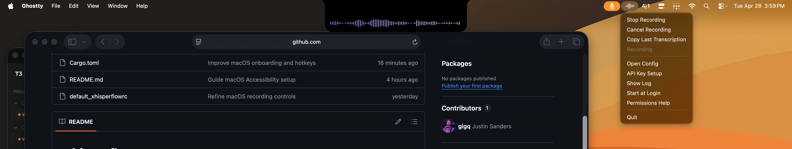

# xhisperflow

xhisperflow records your voice, transcribes it on your machine, optionally removes
spoken disfluencies with a local LLM, and pastes the result into the active app.
All speech recognition and cleanup run locally. No API keys or inference services
are used. Network access is needed only when installing models and runtimes.

On macOS it is a native Rust menu bar app with global hotkeys, permission setup,
and direct paste. Linux provides hotkey-friendly command-line tools. Both display
a floating waveform while recording and a processing animation during inference.



## Build and install

```sh
cargo build --release --features vulkan --bins # Linux GPU build
install -Dm755 target/release/xhisperflow ~/.local/bin/xhisperflow
install -Dm755 scripts/xhisperflow-toggle ~/.local/bin/xhisperflow-toggle
```

The default build includes Whisper and Parakeet. Building needs CMake, a C/C++
compiler, and libclang; Vulkan builds also need Vulkan headers and `glslc`.
`--no-default-features` omits the embedded Whisper and Parakeet engines; the
separately installed Qwen runtime remains available. There is no external engine
adapter or automatic backend fallback. A missing model produces an installation
error. Input audio is never retried against an inference service.

## Speech models

Install the models you want once, then select one:

```sh
scripts/setup-local-transcription.sh large-v3-turbo
scripts/setup-local-transcription.sh parakeet
scripts/setup-local-transcription.sh qwen
xhisperflow --select-model whisper
xhisperflow --select-model parakeet
xhisperflow --select-model qwen
```

| Choice | Model | Execution |
| --- | --- | --- |
| `whisper` | Whisper large-v3-turbo | Vulkan on Linux; Metal on macOS |
| `parakeet` | Parakeet TDT 0.6B v3 INT8 | CPU |
| `qwen` | Qwen3-ASR 1.7B Q8_0 | Private resident helper, Vulkan/Metal |

Only the selected speech model is loaded. The resident worker keeps weights and
inference state between recordings. Recording, resampling, HUD, cancellation and
paste are shared across all three engines. Worker requests use a private Unix
socket; native Mac microphone audio is resampled to 16 kHz.

The selector preserves unrelated configuration and refuses to switch during an
active Linux recording. It restarts the active Linux user service or the
app-managed worker. A failed model load restores the previous configuration.
The Mac app reloads configuration before each take. Inspect or stop the worker:

```sh
xhisperflow --transcription-status
xhisperflow --stop-transcription-daemon
```

Restart after changing language, GPU device or thread settings. On Linux an
optional login service preloads the selected model:

```sh
install -Dm644 scripts/xhisperflow-transcription.service ~/.config/systemd/user/xhisperflow-transcription.service
systemctl --user daemon-reload
systemctl --user enable --now xhisperflow-transcription.service
```

Stop any app-managed worker before first enabling this service. Subsequently,
restart it with `systemctl --user restart xhisperflow-transcription.service`.

Whisper uses [whisper-rs](https://github.com/tazz4843/whisper-rs) and the model
export from [whisper.cpp](https://huggingface.co/ggerganov/whisper.cpp).
Parakeet uses [NVIDIA's TDT v3](https://huggingface.co/nvidia/parakeet-tdt-0.6b-v3)
through parakeet-rs with a statically linked ONNX Runtime. Its installer requires
Python 3.8+ and curl and verifies the export manifest's file sizes and SHA-256
hashes. `parakeet-tdt-0.6b-v3` is also supported as an exact model choice. It
detects its supported languages and emits punctuation; it does not use Whisper
prompts or translate speech.

Qwen uses a pinned [transcribe.cpp](https://github.com/handy-computer/transcribe.cpp)
runtime and its [Q8_0 conversion](https://huggingface.co/handy-computer/Qwen3-ASR-1.7B-gguf)
of the original Qwen3-ASR-1.7B checkpoint rather than the Transformers `-hf`
package. The 2.19 GB model is checksum-verified. Setup builds a private helper
with git, CMake and a C++17 compiler; there is no Python inference process. A
separate process isolates its ggml symbols from Whisper's. Unexpected exit or
timeout produces an error, and the next take can restart the helper.

## Optional VoiceInk cleanup

Install the local cleanup runtime and preview text without recording or pasting:

```sh
scripts/setup-local-cleanup.sh
xhisperflow --cleanup-text 'Um, I would, uh, like to keep Qwen enabled.'
xhisperflow --cleanup-status
xhisperflow --cleanup on
xhisperflow --cleanup off
```

Cleanup is independent of speech model selection and disabled by default. The
`off` command disables it and unloads its resident worker. A preview starts that
worker without enabling automatic cleanup and returns JSON containing `text`,
`accepted`, `reason`, and `elapsed_ms`. An unchanged proposal may also pass
validation. Use `xhisperflow --log` to compare raw and final dictated text with
separate timings.

The model is [VoiceInk's Qwen3.5-2B fine-tune](https://github.com/hourliert/VoiceInk-Qwen3.5-2B-FT)
at Q4_K_M (1.27 GB on disk), using a pinned checksum-verified llama.cpp runtime.
No Ollama installation is needed. Both app RPC and model HTTP use private Unix
sockets. Reasoning, tools and the web UI are disabled. No clipboard or window
context is collected. The cleanup worker logs timing/acceptance metadata only;
the app's dictation log contains raw and final text.

The model proposes deletions; the app validates and rebuilds from source words.
Generated substitutions, additions and reordered words are rejected. Negations,
conditions, numbers, code, proper names and qualifications receive additional
checks, with limited exceptions for clear spoken corrections and duplicate starts.
These checks cannot prove semantic fidelity; ambiguous backtracking may remain
unchanged. It does not guess speech recognition mistakes or execute formatting
commands. Cold startup, missing assets, errors, invalid edits and timeouts preserve
the original transcript. The default deadline is 750 ms, and inputs exceeding
3000 UTF-8 bytes are skipped.

On the development RX 9070 XT machine, short warmed cleanup requests added about
0.08–0.18 seconds. Resident cleanup added about 1.34 GiB VRAM and 0.69 GiB RSS.
Memory and latency depend on text length. Shared Mac code uses Metal; Mac runtime
validation is pending.

## Configuration

Copy [default_xhisperflowrc](./default_xhisperflowrc) to:

- Linux: `~/.config/xhisperflow/xhisperflowrc`
- macOS: `~/Library/Application Support/xhisperflow/xhisperflowrc`

Key settings:

```text
engine : "qwen"
model : "Qwen3-ASR-1.7B-Q8_0"
language : "en"
threads : 4
gpu-device : 0
transcription-timeout : 120
transcription-prompt : ""
cleanup-enabled : true
cleanup-timeout-ms : 750
```

Existing `local-*` model and cleanup setting names remain accepted as read
aliases. Model selection and cleanup toggles write the shorter names. Obsolete
backend/API/post-processing settings are ignored and can be removed. Configuration
has no selectable network inference backend, endpoint or credential settings.

## Linux dictation and insertion

Bind `xhisperflow` or `xhisperflow-toggle` to start/finish recording, and
`xhisperflow --cancel` to discard it. The toggle wrapper debounces release events.
It does not load credential files. Desktop/compositor shortcuts remain external.

Runtime tools:

- `pw-record`, `arecord`, and `notify-send` for recording, level monitoring and
  notification fallback.
- `wtype` for direct Wayland typing or a clipboard paste shortcut.
- `wl-copy`/`wl-paste` or `xclip` for clipboard access.
- Optional `xhisperflowtool`/`xhisperflowtoold` and `/dev/uinput` access for legacy
  helper typing, clipboard and wrap-key workflows.

`output-method : "paste"` performs one clipboard paste instead of simulating
individual characters. On Wayland it needs `wl-copy` and `wtype`, waits for
clipboard ownership and keyboard initialization, and leaves the transcript on the
clipboard for reliable delayed reads. It never submits your message. Set
`paste-keys` to `ctrl+v`, `ctrl+shift+v`, or `shift+insert`. `type` and the legacy
`clipboard` helper mode remain available.

On Wayland the HUD uses `wlr-layer-shell` at the top center of the display. It
falls back to X11/XWayland when available, then notification levels. Recording
shows microphone levels; processing shows a repeating ripple animation.

## macOS

```sh
scripts/build-macos-app.sh
open target/xhisperflow.app
```

The bundle build enables Metal and embeds its shader library. The app defaults
to Option+Space to record and Control+Shift to cancel. `hotkey` and `cancel-hotkey`
accept standard or modifier-only chords; an empty cancel binding disables it.

Microphone permission is required for recording, and Accessibility permission for
Command+V paste. Permissions Help opens the setup flow. If paste is not allowed,
the transcript remains on the clipboard. The menu also provides recording,
cancellation, copy-last, configuration/log access, and Start at Login through a
per-user LaunchAgent. Models must be installed before first use; there is no
credential onboarding.

On both platforms, `floating-waveform` controls the HUD, and
`waveform-gradient-start`/`waveform-gradient-end` accept quoted `#RRGGBB` colors.
Existing `mac-*` waveform names are accepted for compatibility.

## File transcription

```sh
xhisperflow --transcribe-file /path/to/audio.wav
```

This uses the same selected model and cleanup settings as dictation, writes final
text to stdout and errors to stderr, and leaves recording, HUD, clipboard and
focus untouched. For a host integration such as Omarchy Remote:

```sh
OMARCHY_DICTATION_COMMAND='["xhisperflow","--transcribe-file","{audio}"]'
```

## Release builds

Pushing a `v*` tag runs the release workflow, which publishes a Linux tarball and
a universal macOS DMG. See the build scripts and release workflow for signing and
notarization configuration.
